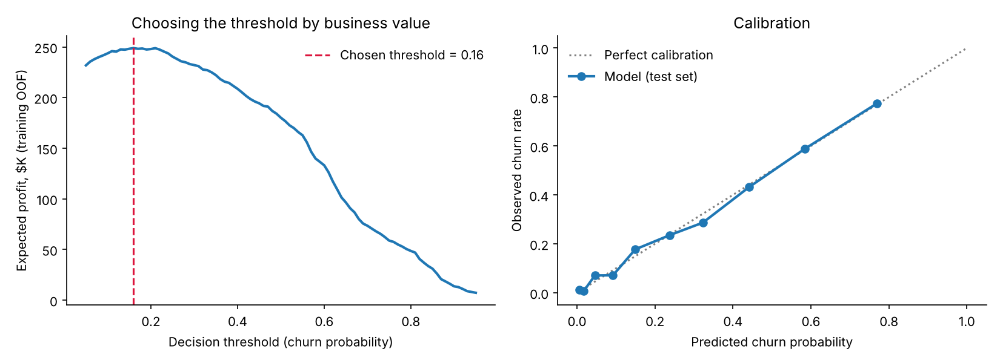
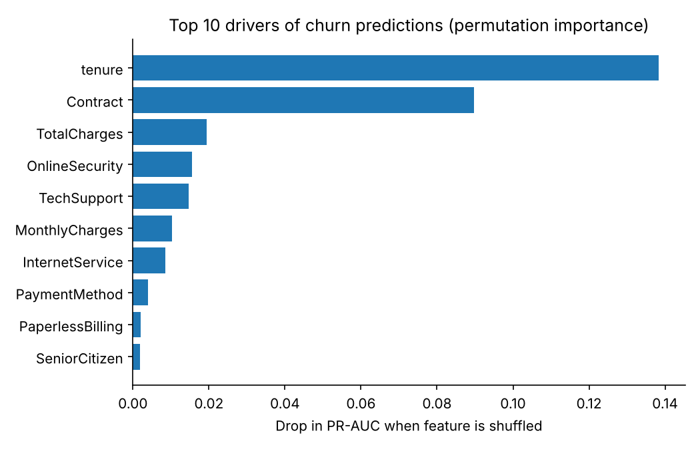

# Customer Churn Prediction: From Model to Production API


A production-style machine learning pipeline that predicts which telecom customers will cancel, chooses *who should get a retention offer* by expected profit, and serves predictions through a tested, containerized REST API.

**Results on held-out test data (1,409 customers):**

| | |
|---|---|
| ROC-AUC | **0.846** |
| PR-AUC | **0.661** (baseline churn rate: 26.5%) |
| Recall at chosen threshold | **90%** of churners reached |
| Expected retention profit | **$60.3K**, vs. $53.0K for a "target all month-to-month customers" rule and $41.6K for "offer everyone" |

---

## Why this project is built the way it is

Most churn notebooks stop at "AUC = 0.85." A model only creates value when someone can **act** on it, so this project covers the whole path:

```
raw CSV ─► validation ─► feature engineering ─► model comparison (CV)
       ─► probability calibration ─► profit-based threshold ─► test-set evaluation
       ─► saved artifact ─► FastAPI service ─► Docker ─► CI tests on every push
```

## 1. Data
[IBM Telco Customer Churn](https://github.com/IBM/telco-customer-churn-on-icp4d): 7,043 customers, 19 features (contract, services, billing, tenure), 26.5% churn.

**Data quality fix:** `TotalCharges` is stored as text, and 11 customers with `tenure = 0` have a blank value. They haven't been billed yet, so the correct value is `0`. Dropping or mean-imputing them would be wrong. `validate()` also fails loudly on missing columns or negative values, so bad data never silently reaches the model.

## 2. Feature engineering
Implemented as an sklearn transformer, so **the exact same code runs in training and in the API** (no train/serve skew):

| Feature | Business intuition |
|---|---|
| `num_addon_services` | More services → higher switching cost → lower churn |
| `avg_monthly_spend` | Lifetime average bill (TotalCharges / tenure) |
| `charge_increase_ratio` | Current bill vs. lifetime average; a price increase is a churn trigger |
| `is_new_customer` | The first 6 months are the highest-risk window |

## 3. Model selection
Stratified 5-fold CV on the training set, scored by **PR-AUC**. PR-AUC is more informative than accuracy or ROC-AUC when the positive class is a minority.

| Model | CV PR-AUC |
|---|---|
| Logistic regression | 0.662 ± 0.016 |
| Random forest | 0.662 ± 0.022 |
| **XGBoost** | **0.665 ± 0.019** |

**Honest read:** the three models are within one standard deviation of each other. XGBoost is selected by the pre-set rule. If interpretability for a business team mattered more than a 0.003 gain, logistic regression would be an equally defensible choice.

## 4. Calibration and choosing the threshold by profit


- **Calibration** (isotonic): when the model says 40%, about 40% of those customers really churn. That matters because the probability feeds directly into a dollar calculation.
- **Threshold:** a 0.5 cutoff is arbitrary. Each retention offer costs **$40**, and it saves **30%** of true churners, each worth **12 months of revenue**. Missing a churner costs far more than an unnecessary offer, so the profit-maximizing threshold is **0.16**. It is selected on *out-of-fold training predictions* so the test set stays untouched.

All business assumptions live in [`src/churn/config.py`](src/churn/config.py) and can be changed in one place.

## 5. What drives churn?


Tenure and contract type dominate: new, month-to-month customers are the highest-risk group. Add-on services like online security and tech support are protective, which suggests bundling them into the retention offer.

## 6. Serving: REST API

```bash
make serve          # http://127.0.0.1:8000/docs for interactive docs
```

```bash
curl -X POST localhost:8000/predict -H "Content-Type: application/json" -d '{
  "gender": "Female", "SeniorCitizen": 0, "Partner": "No", "Dependents": "No",
  "tenure": 2, "PhoneService": "Yes", "MultipleLines": "No",
  "InternetService": "Fiber optic", "OnlineSecurity": "No", "OnlineBackup": "No",
  "DeviceProtection": "No", "TechSupport": "No", "StreamingTV": "Yes",
  "StreamingMovies": "No", "Contract": "Month-to-month", "PaperlessBilling": "Yes",
  "PaymentMethod": "Electronic check", "MonthlyCharges": 85.5, "TotalCharges": 171.0}'
```
```json
{"churn_probability": 0.842, "send_retention_offer": true, "risk_tier": "high"}
```

| Endpoint | Purpose |
|---|---|
| `GET /health` | Liveness check, plus model name, training time and threshold |
| `POST /predict` | Score one customer |
| `POST /predict/batch` | Score up to 1,000 customers |

Inputs are validated with Pydantic: an invalid contract type or a negative tenure returns `422`, not a silent bad prediction.

## 7. Engineering practices
- **Tests** (`pytest`, 12 tests): data cleaning, schema validation, feature logic, unseen categories, profit math, and API contract tests, including a sanity check that a loyal two-year customer scores lower than a brand-new month-to-month one
- **CI** (GitHub Actions): lint → train → test on every push
- **Docker:** the image trains the model at build time, so the artifact always matches the installed library versions
- **Reproducibility:** fixed random seeds, pinned dependencies, and the metrics and metadata saved with every model (`models/metrics.json`)

## Project structure
```
src/churn/
  config.py      # paths, features, business assumptions
  data.py        # load, clean, validate, split
  features.py    # feature engineering transformer + preprocessing pipeline
  train.py       # compare, calibrate, threshold, evaluate, save
  predict.py     # load artifact and score
  api.py         # FastAPI service
tests/           # unit + API tests
Dockerfile, Makefile, .github/workflows/ci.yml
```

## Quick start
```bash
make install
make train      # ~15 seconds; writes models/ and figures/
make test
make serve
# or: make docker
```

## Next steps for a real deployment
- Monitor input drift (for example the share of month-to-month customers) and the live churn rate against predictions
- Run an A/B test of the retention offer itself to measure the real success rate in place of the 30% assumption
- Uplift modeling: target customers who are *persuadable*, not just likely to churn
